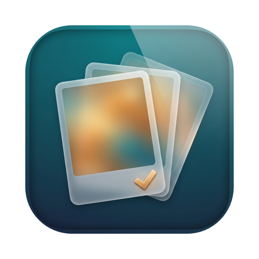

# Winnow

**Tidy up your Apple Photos library on your Mac and keep the shots you love.** Winnow finds similar shots and exact duplicates, recommends the best photo
in each group, lets you review everything quickly from the keyboard, and shrinks
oversized videos. It works directly on your Photos library, and nothing leaves your Mac.

<p align="center"></p>

## What it does

- **Similar photos.** On-device Apple Vision finds near-duplicates, bursts and
  "same moment" shots. A tolerance slider regroups instantly: do a tight pass first,
  then loosen it to keep only the best moments. Photos you kept in an earlier pass are
  marked so you can focus on what's new.
- **Best shot picked for you.** Each group is scored on aesthetics, sharpness and face
  quality; the best is pre-selected and the score is shown. Nothing changes until you confirm.
- **Exact duplicates across the whole library**, any date: photos imported twice years
  apart, and duplicate videos (often the biggest win), sorted by space freed.
- **Video compression.** Re-encodes videos to HEVC at a quality level you choose, checks
  each one would actually get meaningfully smaller, lets you compare the original and the
  compressed copy side by side or with a wipe slider, then replaces originals while
  keeping date, location, favourite and albums.
- **Keyboard first.** Arrows, Space, Return, O/K/D, ⌘Z… press `?` for the full list.
- **Scan any album**, smart album or folder, or the whole library.

## Safety

- **Nothing is deleted without your confirmation.** Rejects go to Winnow's *To Delete*
  bin first, where you can restore them. "Move to Recently Deleted" sends them to
  Photos in one batch; macOS asks you once.
- **Everything is recoverable for 30 days** from Photos › Recently Deleted.
- **Favourites are always kept** by default.
- **Video replace is all-or-nothing:** if you decline the macOS prompt, nothing changes.
- **Private:** all analysis runs on your Mac. No accounts, no analytics, no network calls.

> Winnow is a free, personal open-source project with no warranty. Make sure you have
> a backup of your Photos library (Time Machine, or iCloud Photos) before deleting things.

## Download

Requires **macOS 26 or later** (universal: Apple silicon and Intel; Intel is untested).

1. Download **Winnow-x.y.z.zip** from the [latest release](https://github.com/alimuqeem/winnow/releases/latest)
   and double-click it to unzip.
2. Drag **Winnow.app** into your Applications folder.
3. Open it. Because this free build isn't notarised by Apple, macOS will say it
   can't verify the app. Click **Done** (not Move to Bin), then open
   **System Settings › Privacy & Security**, scroll down to the message about Winnow
   and click **Open Anyway**, then confirm. You only do this once.
4. When asked for Photos access, choose **Allow Full Access**.

<details>
<summary>Prefer the Terminal?</summary>

```sh
xattr -dr com.apple.quarantine /Applications/Winnow.app
open /Applications/Winnow.app
```
</details>

Each release lists a SHA-256 checksum so you can check the download:
`shasum -a 256 ~/Downloads/Winnow-*.zip`. If you'd rather not run a downloaded
binary, build it yourself from source; it's the same code.

## Build from source

Requirements:

- macOS 26 or later
- Xcode 26 or later
- [XcodeGen](https://github.com/yonaskolb/XcodeGen) (`brew install xcodegen`)
- A free Apple ID signed in to Xcode (Xcode › Settings › Accounts) for code signing

```sh
git clone https://github.com/alimuqeem/winnow.git
cd winnow
cp local.env.example local.env      # then edit it: your Team ID and a bundle prefix
scripts/bootstrap.sh                # generates Winnow.xcodeproj
CONFIG=Release scripts/xc.sh build
open build/DerivedData/Build/Products/Release/Winnow.app
```

Your **Team ID** is shown in Xcode › Settings › Accounts (select your Apple ID; a free
account appears as "Your Name (Personal Team)"), or run
`defaults read com.apple.dt.Xcode IDEProvisioningTeamByIdentifier`. Use any bundle
prefix you own, such as `com.yourname`.

Signing with a real team (not "Sign to Run Locally") matters: macOS ties the Photos
permission to the app's signature, and an ad-hoc signature changes on every build.

On first launch macOS asks for Photos access; choose **Allow Full Access**.

### First scan

The first scan analyses every photo once (about 6–7 minutes per 30,000 photos on an
M1 Max). Results are cached, so later scans take seconds. You can quit at any time and
it resumes where it left off.

## Development

```sh
scripts/xc.sh test        # unit tests (WinnowCore)
scripts/check-core.sh     # core build + smoke test with plain swiftc (no Xcode needed)
scripts/release.sh        # universal, ad-hoc signed Winnow-<version>.zip in build/release
```

Self-tests run against your real library and **never delete anything**:

```sh
open -g -n build/DerivedData/Build/Products/Release/Winnow.app --args --selftest all
open -g -n …/Winnow.app --args --selftest --duplicates
open -g -n …/Winnow.app --args --selftest --video
cat ~/Library/Application\ Support/Winnow/selftest/report.txt
```

See [docs/DESIGN.md](docs/DESIGN.md) for how it works and the measurements behind
the design.

### Project layout

```
project.yml              XcodeGen spec (the .xcodeproj is generated, not committed)
Sources/WinnowCore/      pure-Swift logic: grouping, duplicates, recommendation, review state
Sources/Winnow/          SwiftUI app: Services (PhotoKit, Vision, SQLite, AVFoundation), Model, Views
Tests/WinnowCoreTests/   XCTest suite
scripts/                 bootstrap, build/test wrapper, icon generator
docs/                    design notes, brand assets and prompts
```

### Data

`~/Library/Application Support/Winnow/` holds the analysis cache, the To Delete bin
and review history (`winnow.sqlite`) and the cached video list. Deleting the folder
only costs a rescan, but the To Delete bin is lost.

## Keyboard

| Review | |
|---|---|
| ← → | previous / next photo · ⇧ to multi-select |
| Space | toggle keep |
| Return | confirm group, next |
| ↑ ↓ · N | previous / next group · skip |
| O · K · D | keep just this · keep all · delete all |
| A | accept all picks |
| R · ⌘Z · ⇧⌘Z | reset · undo · redo |
| F · I · ? | full size · score details · help |

Video compare: Space play/pause · ← → previous/next · W wipe · Esc close.

## Licence

MIT. See [LICENSE](LICENSE).
